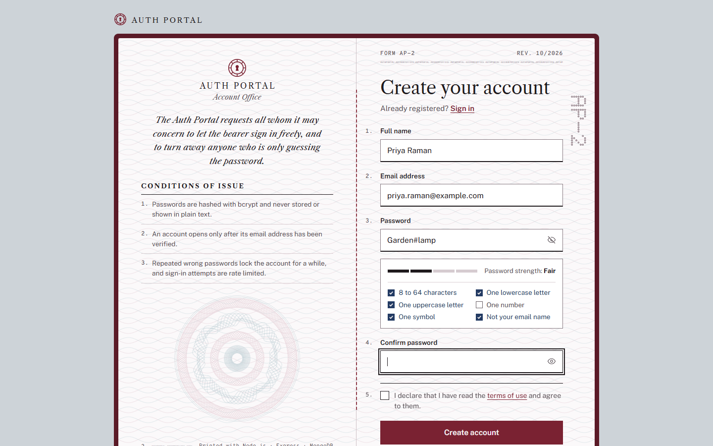
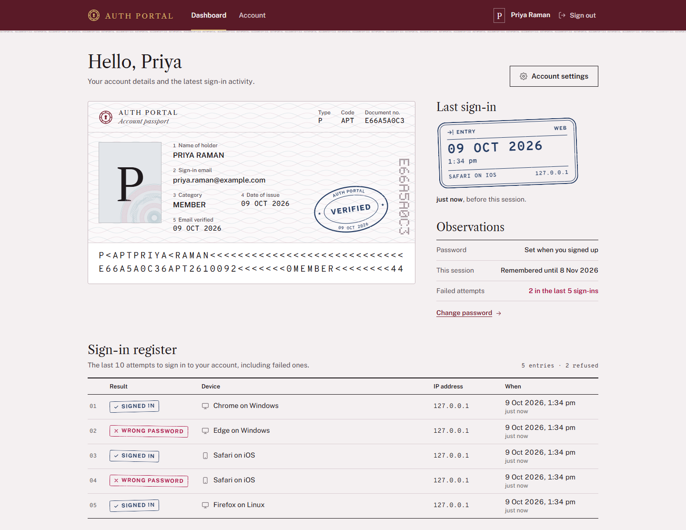
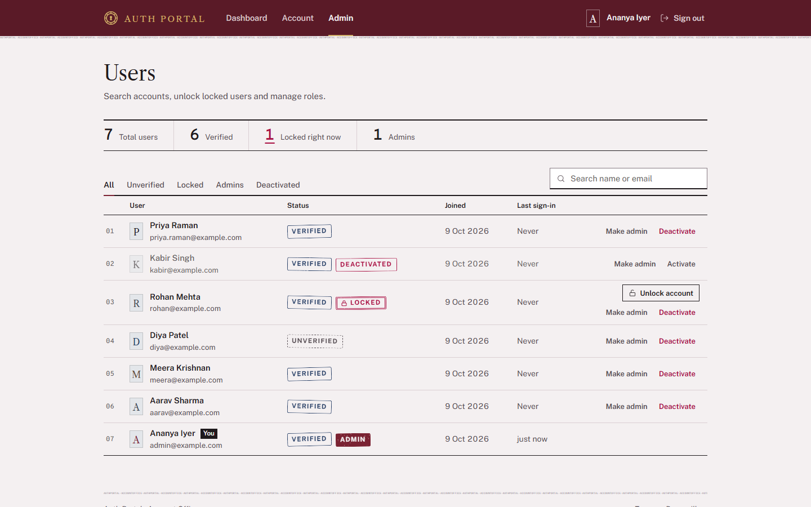
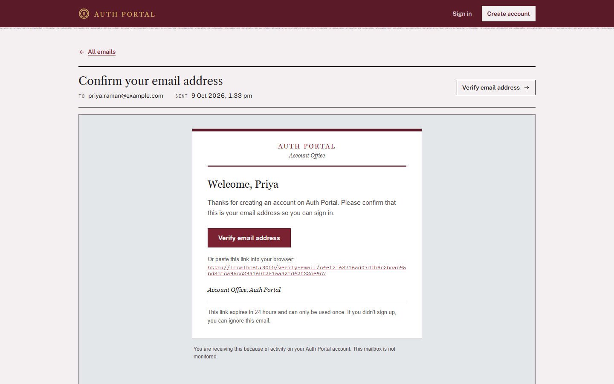
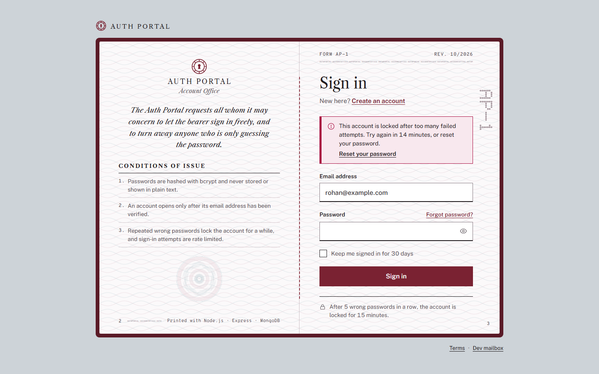
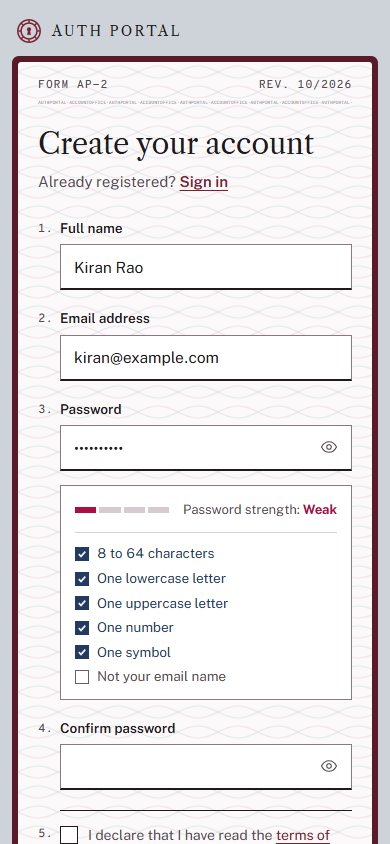
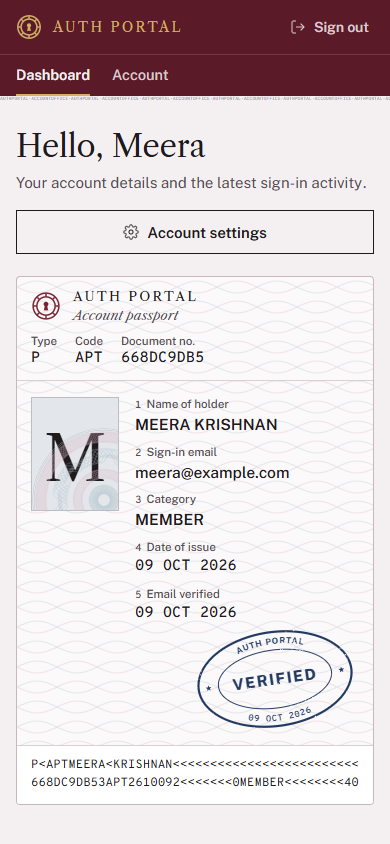
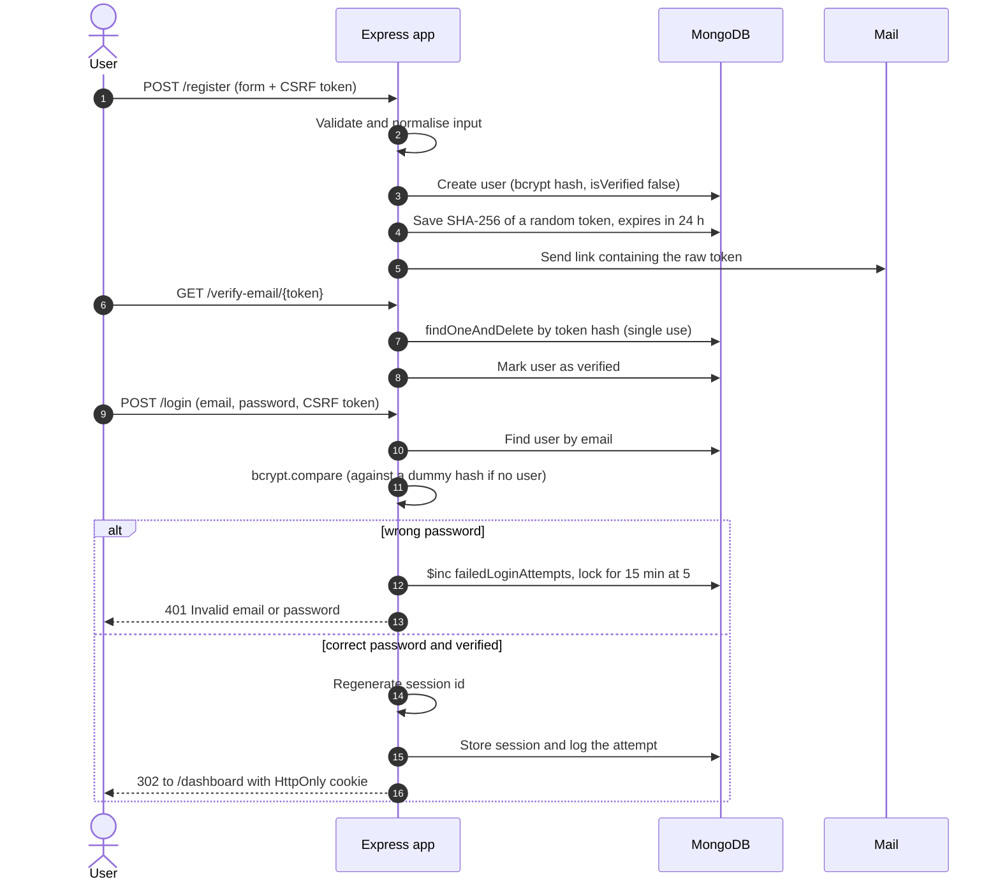

# Auth Portal

A login and registration system built with Node.js, Express and MongoDB: sign-up with server-side validation, bcrypt password hashing, email verification, account lockout, password reset and a small admin panel. The interface is styled as a passport office: the sign-in and sign-up forms are printed in an open passport booklet, and the dashboard is laid out as the account's passport data page.




I built this to understand what "secure login" actually involves beyond hashing a password. Most tutorials stop at `bcrypt.compare`; this project also covers the parts around it: what the login form says when something goes wrong, how reset links are stored, what happens to other sessions when a password changes, and how to stop someone from guessing passwords all night.

## Features

**Registration**
- Full name, email, password, confirm password and terms checkbox
- Server-side validation with express-validator: trimming, email normalisation, length limits, duplicate email check
- Password policy: 8 to 64 characters with upper case, lower case, a digit and a symbol, and it can't contain the name part of your email
- Live checklist, strength meter (my own scoring function) and show/hide toggle in the browser
- Errors appear under the field that caused them, and the form keeps what you typed (except passwords)

**Email verification**
- Random 32-byte token, only its SHA-256 hash is stored, expires in 24 hours, works once
- Sign-in is blocked until the address is verified; "resend link" is rate limited and doesn't reveal whether the email is registered
- HTML emails (with a plain-text version) sent through SMTP. Outside production every email is also kept in a development mailbox at `/dev/mailbox`, so the whole flow works without an SMTP account

**Sign in and sessions**
- "Keep me signed in" switches between a 30-day cookie and a browser-session cookie
- The same "Invalid email or password." message for a wrong password and for an unknown email
- Account locks for 15 minutes after 5 wrong passwords in a row (and the owner gets an email)
- Per-IP rate limit on `POST /login`
- New session id on every sign-in, session destroyed on sign-out
- Every sign-in attempt that reaches the password check is logged with result, IP and user agent

**Password reset**
- Same response whether or not the account exists
- Hashed, single-use token that expires in 30 minutes
- New password goes through the same policy, every other session is signed out, and a "your password was changed" email is sent
- A successful reset also lifts a lockout and marks the email as verified, because the link proved the person can read that inbox

**Account area**
- Dashboard laid out as a passport data page: account details, a machine-readable zone in the ICAO 9303 passport format (check digits included) built from the account, the last sign-in (time, IP, device) as an entry stamp, and a register of the last 10 sign-in attempts labelled like "Chrome on Windows"
- Change password (needs the current one, signs out other devices), edit name, delete account (needs the password and typing DELETE; the only admin can't delete their own account)

**Admin panel**
- Users table with search, status filters, counters and badges for verified / unverified / locked / admin / deactivated
- Unlock accounts, make or remove admins, deactivate or reactivate users
- Admins can't demote or deactivate themselves

**Interface**
- The sign-in, sign-up, email verification and password reset pages are an open passport booklet: conditions of issue on the left page, the form on the right, with a perforated form number
- Status badges and confirmations are styled as rubber stamps, and the page backgrounds use guilloche and microprint patterns drawn in SVG and CSS
- Libre Caslon Text for headings, Public Sans for the interface and Overpass Mono for codes, all self-hosted because the Content Security Policy only allows fonts from the app itself
- Works down to phone width (see the screenshots below)

## Security measures

Paths in the "Where" column are relative to `src/`, except the one that starts with `public/`.

| Threat | What the app does | Where |
| --- | --- | --- |
| Stolen database dump | Passwords hashed with bcrypt (cost 12). Verification and reset tokens stored only as SHA-256 hashes | `models/User.js`, `services/tokens.js` |
| Password guessing on one account | 5 consecutive failures lock the account for 15 minutes. The counter uses `$inc` so parallel requests can't skip the lock | `models/User.js`, `controllers/authController.js` |
| Credential stuffing from one IP | `express-rate-limit` on sign-in, resend-verification and forgot-password | `middleware/rateLimits.js` |
| Finding out which emails are registered | Generic sign-in error, identical forgot-password and resend responses, bcrypt compare against a dummy hash when the email doesn't exist | `controllers/authController.js` |
| CSRF | Synchronizer token stored in the session and checked on every POST, plus `SameSite=Lax` cookies | `middleware/csrf.js` |
| Session fixation | A new session id is issued on sign-in | `utils/session.js` |
| Session hijacking via XSS | `HttpOnly` cookies, strict Content Security Policy with no inline scripts or styles, all output escaped by EJS | `app.js`, `public/js/` |
| Old sessions after a password change | Each user has a `sessionVersion`; changing the password bumps it and every other session is rejected on its next request | `middleware/auth.js` |
| NoSQL injection | Requests with non-string fields are rejected with 400, and Mongoose `sanitizeFilter` wraps any `$` operator that still reaches a query | `middleware/sanitize.js`, `config/db.js` |
| Open redirect after sign-in | "Return to" path accepted only if it is a local path | `utils/session.js` |
| Oversized payloads | Body parsers limited to 10 kb, forms to 50 fields | `app.js` |
| Leaking internals | `x-powered-by` off, central error handler, stack traces only outside production | `app.js`, `middleware/errors.js` |
| Misconfigured deploy | The app refuses to start in production without `SESSION_SECRET`, `MONGODB_URI`, `APP_URL` and `SMTP_HOST`. Cookies are `Secure`, HSTS is on and `trust proxy` is set | `config/index.js`, `app.js` |

## Screenshots

| Dashboard (data page and sign-in register) | Admin panel |
| --- | --- |
|  |  |
| **Verification email in the dev mailbox** | **Locked account after 5 failed attempts** |
|  |  |

<p align="center">
  
  
</p>

More in [`docs/screenshots`](docs/screenshots): the sign-in error, the "check your email" page, the email verified page, the change-password form with a validation error, the dev mailbox and the admin panel after unlocking an account.

## Tech stack

| Layer | Used |
| --- | --- |
| Runtime | Node.js 20.19+ (developed on Node 24), CommonJS |
| Server | Express 5, EJS views with partials |
| Database | MongoDB with Mongoose 9, `mongodb-memory-server` for zero-setup development and tests |
| Sessions | express-session with connect-mongo (sessions live in MongoDB) |
| Security | bcrypt, express-validator, helmet, express-rate-limit, hand-written CSRF middleware |
| Email | Nodemailer (SMTP) with an EJS HTML template |
| Front end | Plain CSS and small vanilla JS files, inline SVG icons and stamps, self-hosted WOFF2 fonts, no framework |
| Testing | Jest, Supertest |

## Getting started

### Prerequisites

- Node.js 20.19 or newer, with npm
- MongoDB is optional for development. Without it the app runs on an in-memory database; for data that survives a restart, use a local MongoDB server or MongoDB Atlas

### Install and run (no database needed)

```bash
git clone https://github.com/preransai/auth-portal.git
cd auth-portal
npm install
npm run dev
```

Open http://localhost:3000. Without `MONGODB_URI` the app starts an in-memory MongoDB, creates the demo accounts below and prints them in the terminal. Everything is wiped when the server stops (nodemon restarts included). `npm install` also downloads a MongoDB server binary for the in-memory database (it is cached for later runs), so the first install takes a little longer.

Emails aren't sent anywhere in this mode. Open http://localhost:3000/dev/mailbox to read them and click the links. The link is also printed in the terminal.

### Configure (real MongoDB, SMTP)

```bash
cp .env.example .env     # Windows Command Prompt: copy .env.example .env
# set MONGODB_URI, for example
# MONGODB_URI=mongodb://127.0.0.1:27017/auth-portal
# MONGODB_URI=mongodb+srv://<user>:<password>@<cluster>.mongodb.net/auth-portal
npm run seed     # optional: creates the demo accounts
npm run dev
```

For production use `npm start` with `NODE_ENV=production`. The app then needs a session secret, a database, a public URL and an SMTP server, and it disables the dev mailbox. Cookies are marked `Secure` in production, so serve it over HTTPS (usually behind a reverse proxy).

### Environment variables

| Variable | Default | Notes |
| --- | --- | --- |
| `NODE_ENV` | `development` | `production` turns on secure cookies and strict startup checks |
| `PORT` | `3000` | |
| `APP_URL` | `http://localhost:PORT` | Used to build links in emails. Required in production |
| `MONGODB_URI` | empty | Empty means in-memory MongoDB (development only) |
| `SESSION_SECRET` | dev-only value | Required in production. Use a long random string |
| `SMTP_HOST`, `SMTP_PORT`, `SMTP_SECURE`, `SMTP_USER`, `SMTP_PASS` | empty, 587, false | `SMTP_HOST` is required in production. Outside production every email is also kept at `/dev/mailbox`, so these can stay empty |
| `MAIL_FROM` | `Auth Portal <no-reply@example.com>` | |
| `TRUST_PROXY` | `1` in production, else `0` | Number of proxies in front of the app |
| `LOGIN_RATE_LIMIT` | `20` | Sign-in requests per IP per 15 minutes |
| `EMAIL_RATE_LIMIT` | `5` | Forgot-password and resend requests per IP per 15 minutes |
| `APP_NAME` | `Auth Portal` | Name shown in the interface and in emails |
| `APP_TIME_ZONE` | `Asia/Kolkata` | Time zone for every date and time the app prints |

## Demo accounts

All of them use the password `Demo@12345`. They are created automatically with the in-memory database, or by `npm run seed` against a real one.

| Email | What it shows |
| --- | --- |
| `admin@example.com` | Admin, can open the admin panel |
| `aarav@example.com` | Normal verified user |
| `meera@example.com` | Normal verified user |
| `diya@example.com` | Hasn't verified her email, so sign-in is blocked |
| `rohan@example.com` | Locked for 15 minutes after the seed runs |
| `kabir@example.com` | Deactivated by an admin |

## Running tests

```bash
npm test
```

The suite starts one in-memory MongoDB, gives every test file its own database and runs serially. It currently has 97 tests in 10 files and finishes in under a minute. bcrypt runs at cost 4 under test so the suite stays fast; a separate test checks that production uses cost 12.

What's covered:
- registration validation messages, password policy, duplicate emails, bcrypt hashing, and that the hash is never selected by default or included in `toJSON()`
- verification links: valid, reused, expired, replaced by a resend
- sign-in success and failure, identical messages for wrong password and unknown email, unverified and deactivated accounts, session id rotation, remember-me cookie, sign-out
- lockout after 5 failures, unlocking after the window, parallel guesses, per-IP 429 responses
- forgot-password non-enumeration, reset tokens being single use and expiring, other sessions signed out after a reset
- CSRF rejection, NoSQL injection payloads, security headers, body size limit
- protected routes, admin-only routes returning 403, admin actions and the "can't demote yourself" rule
- the dashboard helpers: machine-readable zone length and check digits, dates in the app time zone, initials for names in any script, user agent labels

## Project structure

```
auth-portal/
  src/
    app.js               Express app: helmet, parsers, sessions, CSRF, routes
    server.js            Starts MongoDB (real or in-memory) and the HTTP server
    config/              Environment config and database connection
    models/              User, Token, LoginAttempt
    routes/              auth, account, admin, dev mailbox
    controllers/         Request handlers for each area
    middleware/          auth guards, CSRF, flash, rate limits, input sanitising, validation, errors
    validators/          express-validator rule chains and the password policy
    services/            mail, email templates, tokens, login activity, seed data
    utils/               session helpers, user agent labels, date formatting, MRZ and perforation helpers
    views/               EJS pages, partials (layout, icons, seals) and the HTML email template
  public/
    css/                 base, forms, components, auth pages and app pages
    js/                  app.js (forms, toasts, show/hide password) and password-tools.js (checklist, strength meter)
    fonts/               self-hosted WOFF2 fonts and their OFL licence files
    img/                 SVG artwork: guilloche rosette, page tint, stamp grain, perforations
    favicon.svg
  scripts/seed.js        npm run seed
  tests/                 Jest + Supertest suites and helpers
  docs/screenshots/      images used in this README
  .env.example           environment variables with comments
```

## How sign-up and sign-in work



## Design decisions

**Sessions instead of JWT.** The app renders its own HTML on one origin, so a cookie-based session is the simplest thing that works. It also makes "log out" and "sign out my other devices" real: the session is deleted on the server. With a stateless JWT I would have needed a deny-list or very short-lived tokens to get the same behaviour, which ends up being a session store anyway.

**Signing out other sessions with a version number.** connect-mongo stores sessions as JSON strings, so "find every session of user X" isn't a simple query. Instead each user has a `sessionVersion` and every session remembers the version it started with. Changing or resetting the password bumps the number, and the auth middleware drops any session that doesn't match. One indexed read per request, and it works with any session store.

**Only token hashes in the database.** Reset and verification links are as good as a password while they're valid. Storing `sha256(token)` means someone who can read the database still can't use the links. SHA-256 is fine here (no bcrypt needed) because the token is 32 random bytes, so there's nothing to brute force. Tokens are consumed with `findOneAndDelete`, which makes them single use even if two requests arrive at the same time.

**Lockout and rate limiting together.** The per-account lockout protects one account from a slow, targeted attack from many IPs. The per-IP limit protects many accounts from one source trying a leaked password list. Either one alone leaves a gap. The downside of lockout is that anyone who knows your email can lock you out for 15 minutes, which is why it's short, it lifts on its own, a password reset clears it, and admins can unlock it.

**When the login form is allowed to be specific.** A wrong password and an unknown email both get "Invalid email or password." The only time the form says more ("this account is locked", "please verify your email", "this account is deactivated") is after the correct password was entered, because at that point the person has already proved they know the account exists.

**Hand-written CSRF middleware.** `csurf` is deprecated, and the synchronizer token pattern only needs a few lines: a random token in the session, a hidden field in every form, a constant-time comparison on every POST. Writing it myself made it clear what it actually protects.

## What I'd improve next

- **Two-factor authentication** with TOTP (authenticator apps) and backup codes.
- **Sign in with Google or GitHub** using OAuth, linked to existing accounts by verified email.
- **Send emails from a background queue.** Right now forgot-password waits for the email to be sent, so an account that exists answers a little slower than one that doesn't. A queue would make both paths take the same time.
- **A "your devices" list** showing each active session with a button to end it, instead of the all-or-nothing sign-out.
- **Check new passwords against known breaches** using the Have I Been Pwned range API.

## Credits

- **Fonts.** Libre Caslon Text (Copyright 2012 The Libre Caslon Text Project Authors), Public Sans (Copyright 2015 The Public Sans Project Authors) and Overpass Mono (Copyright 2021 The Overpass Project Authors) are bundled in [`public/fonts`](public/fonts) under the SIL Open Font License 1.1. Each family's licence text is in the same folder (`OFL-*.txt`).
- **Icons.** A few of the inline SVG icons are adapted from Feather Icons (MIT License) and Lucide (ISC License).

Full details and licence texts are in [THIRD_PARTY_NOTICES.md](THIRD_PARTY_NOTICES.md).

## License

The source code is released under the [MIT License](LICENSE), Copyright (c) 2026 Preran Sai Yarramasu. The bundled fonts are not covered by the MIT License; they keep their SIL Open Font License (see Credits).
